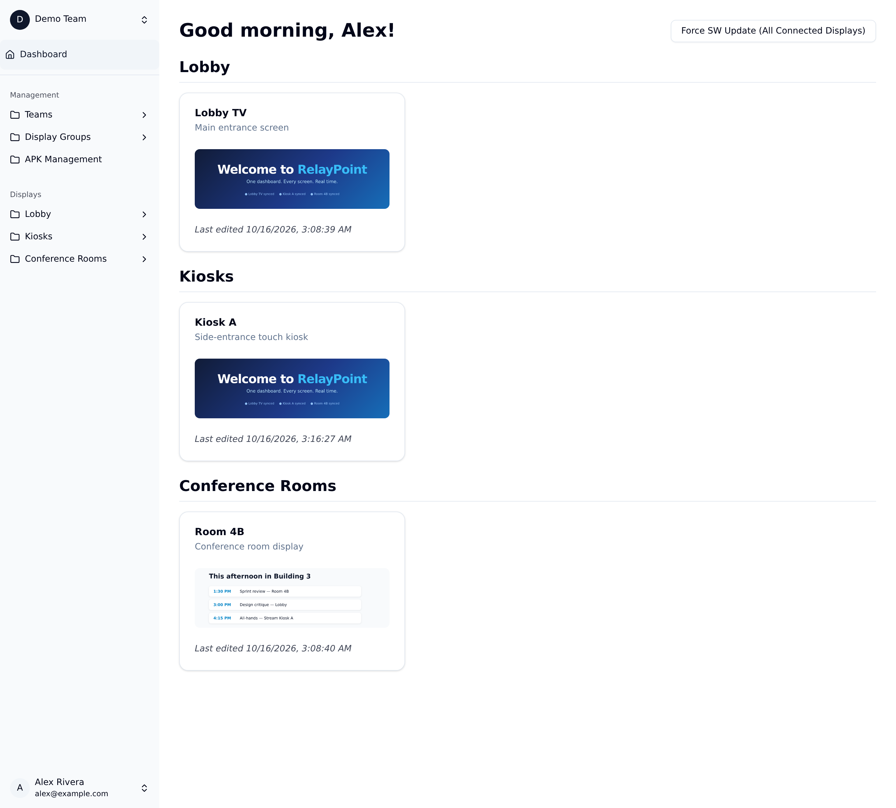

<div align="center">

# RelayPoint

**Open-source digital signage, managed from anywhere.**

Create content, group your screens, and broadcast presentations to every
display in real time.

[](https://github.com/willuhmjs/relaypoint/actions/workflows/ci.yml)
[](./LICENSE)
[](https://nodejs.org)

[Features](#features) · [Quickstart](#quickstart) · [Configuration](#configuration) · [Deployment](#deployment) · [FAQ](#faq) · [Contributing](./CONTRIBUTING.md)

</div>



---

RelayPoint is a self-hosted digital signage platform. A single dashboard lets
you upload images, videos, HTML, and PowerPoint decks, arrange them into
playlists with transitions, and push them to any number of displays — phones,
tablets, browsers, or Android TV boxes — which stay in sync over WebSockets.

## Features

- **Real-time broadcast** — presentations and settings propagate to every
  connected display instantly over WebSockets, with automatic reconnect and
  heartbeat-based client eviction.
- **Rich content pipeline** — upload images, video, and HTML directly, or drop
  in a PowerPoint file and let RelayPoint convert it to slide images
  (Gotenberg + Poppler) with the original kept for download.
- **Playlists & transitions** — order slides, set per-slide durations and
  transition effects, and broadcast a whole group at once.
- **Display groups & teams** — organize screens into groups and manage
  multi-user teams with role-based access.
- **Bring your own auth** — plug in any OAuth/OIDC provider (Google, GitHub,
  Keycloak, or a custom SSO) purely through environment variables. Running
  without an IdP? A built-in email/password login enables itself automatically
  so a fresh install is usable out of the box.
- **Self-hostable** — Postgres + S3-compatible storage + Gotenberg, all wired
  up with Docker Compose.

## Tech stack

SvelteKit (Svelte 5) · TypeScript · Prisma · PostgreSQL · Tailwind CSS +
shadcn-svelte · Auth.js · WebSockets (`ws`) · S3-compatible object storage ·
Playwright.

## Quickstart

The fastest way to try RelayPoint is Docker Compose, which starts Postgres,
MinIO (S3), and Gotenberg alongside the app.

### Prerequisites

- Node.js v22+
- Docker (with the Compose plugin)

### 1. Configure the environment

```sh
cp .env.example .env
```

Open `.env` and set at least:

| Variable                          | Purpose                                                  |
| --------------------------------- | -------------------------------------------------------- |
| `POSTGRES_PASSWORD`               | Password for the Postgres container                      |
| `S3_ACCESS_KEY` / `S3_SECRET_KEY` | MinIO credentials (any non-empty values for local use)   |
| `AUTH_SECRET`                     | Auth.js secret — generate with `openssl rand -base64 32` |

For a quick local login without an OAuth provider, nothing extra is needed:
when no `AUTH_PROVIDERS` are configured, the email/password login form is
enabled automatically. The **first** account you create becomes the admin;
further signups stay closed until you set `AUTH_LOCAL_ALLOW_SIGNUP="true"`.

### 2. Start everything

```sh
docker compose up -d
```

This runs migrations automatically on boot. Open
[http://localhost:3000](http://localhost:3000).

### 3. Promote yourself to admin

The **first** local account created (or, with SSO, the **first** user to sign
in) is automatically granted the admin role. To promote an existing user later:

```sh
npx tsx scripts/promote-admin.ts
```

## Local development

```sh
npm install
cp .env.example .env          # then edit as above
docker compose up -d postgres s3 gotenberg
npx prisma migrate dev
npm run dev
```

See [CONTRIBUTING.md](./CONTRIBUTING.md) for the full development workflow.

## Configuration

All configuration is environment-driven. Key variables:

| Variable                                          | Description                                                |
| ------------------------------------------------- | ---------------------------------------------------------- |
| `ORIGIN` / `APP_URL`                              | Public origin of the app (used for callbacks and links)    |
| `DATABASE_URL`                                    | Postgres connection string                                 |
| `AUTH_SECRET`                                     | Auth.js signing secret (required)                          |
| `AUTH_PROVIDERS`                                  | Comma-separated Auth.js provider ids, e.g. `github,google` |
| `AUTH_<PROVIDER>_ID` / `_SECRET` / `_ISSUER`      | Per-provider credentials (Auth.js convention)              |
| `AUTH_CUSTOM_OIDC_*`                              | Add a generic OIDC provider not in the Auth.js catalog     |
| `AUTH_LOCAL_ENABLED`                              | Force local email/password login on/off (auto by default)  |
| `AUTH_LOCAL_ALLOW_SIGNUP`                         | `true` to let anyone self-register locally                 |
| `AUTH_ADMIN_GROUP`                                | IdP group/role that grants the admin role on login         |
| `PUBLIC_AUTH_PROVIDER_<ID>_LABEL`                 | Override a provider's login-button label                   |
| `PUBLIC_S3_ENDPOINT` / `_BUCKET_NAME` / `_REGION` | S3-compatible storage settings                             |
| `S3_ACCESS_KEY` / `S3_SECRET_KEY`                 | S3 credentials                                             |
| `GOTENBERG_URL`                                   | Gotenberg endpoint for PowerPoint → PDF conversion         |
| `MAX_UPLOAD_BYTES_MB` / `BODY_SIZE_LIMIT`         | Upload cap (app-level / HTTP layer — keep both in sync)    |
| `PUBLIC_ORGANIZATION_NAME`                        | Organization name shown in the UI                          |

The full annotated list lives in [`.env.example`](./.env.example).

## Deployment

The provided [`Dockerfile`](./Dockerfile) builds a production image running a
custom Node server (SvelteKit + the WebSocket layer). Run it behind a
TLS-terminating reverse proxy and point `ORIGIN`/`APP_URL` at the public URL.
The bucket policy in [`public-policy.json`](./public-policy.json) grants public
read to display content by design — display clients fetch slides without
credentials.

## Project structure

```
src/
  lib/
    components/   Svelte components (ui/ = shadcn-svelte primitives)
    server/       Server-side logic: auth, S3, WebSockets, Prisma
    stores/       Client-side state
  routes/         SvelteKit routes (dashboard, display client, API)
prisma/           Database schema and migrations
e2e/              Playwright end-to-end tests
scripts/          Operational CLI (promote-admin)
```

## Testing

```sh
npm run check   # type checking
npm run lint    # ESLint + Prettier
npm run test    # Playwright e2e (seeds its own user/display/session)
```

The e2e suite needs a reachable Postgres and S3 endpoint (see the `DATABASE_URL`
/ `S3_*` env vars in [`.github/workflows/ci.yml`](./.github/workflows/ci.yml)).
On machines where `npx playwright install` cannot download a browser, point
`PLAYWRIGHT_EXECUTABLE_PATH` at an existing Chromium binary.

## FAQ

**Do displays need accounts or logins?**
No. Each display opens a public kiosk URL (`/view/<id>`) in any browser —
Chrome in kiosk mode, a tablet browser, or an Android TV WebView. Clients
receive their playlist from the display API and keep themselves in sync.

**Where does my content live?**
Entirely on your own S3-compatible bucket (MinIO included in the compose
stack). Nothing is proxied through third parties.

**How do screens stay in sync?**
Every slide change broadcasts over a WebSocket, while the carousel itself is
computed from a shared timeline base timestamp — so clocks, not messages, are
the source of truth. Reconnecting clients resync instantly.

**Does it work on flaky networks?**
Clients reconnect with exponential backoff, cache slides in the Service
Worker, and show the last published state while offline.

**Can I use it without an identity provider?**
Yes. With no OAuth/OIDC configured, a local email/password login is enabled
automatically; the first account becomes the admin and self-signup stays
closed unless you opt in.

## Contributing

Contributions are welcome! Please read
[CONTRIBUTING.md](./CONTRIBUTING.md) before opening a pull request. For
security issues, see [SECURITY.md](./SECURITY.md). Planned work lives in
[ROADMAP.md](./ROADMAP.md).

## License

Distributed under the [MIT License](./LICENSE).
